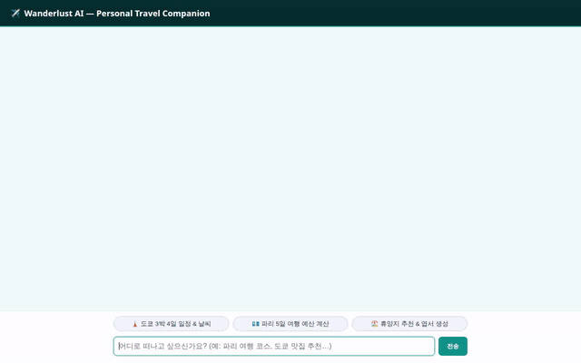

# ✈️ Wanderlust AI — Personal Travel Concierge



> **Wanderlust AI**는 사용자의 여행 취향, 예산, 알레르기 및 식단 제한 사항을 기억하고, 데이터베이스 명소 조회부터 실시간 날씨, 경로 탐색, 예산 계산, 시네마틱 엽서 및 비디오 생성까지 원스톱으로 지원하는 AI 여행 컨시어지 에이전트입니다.

---

## 🌟 주요 기능 및 아키텍처

`app/agent.py`와 `agents-cli-manifest.yaml`에 기반하여 구현된 실제 프로덕션 기능입니다.

### 1. 🧠 장기 기억 저장소 (Memory Bank)
- **Vertex AI Memory Bank** (`PreloadMemoryTool` & `generate_memories_callback`) 연동.
- 세션이 달라져도 사용자의 여행 스타일(미식, 힐링, 배낭여행 등)과 **알레르기/식이 제한 사항(땅콩 알레르기, 비건, 글루텐 프리 등)**을 영구적으로 기억하여 식당 및 일정 추천에 반영.

### 2. 🗄️ 정형 데이터 관리 (Firestore)
- **`destinations` 컬렉션**: 여행지 카탈로그(도쿄, 교토, 파리 등)의 스타일, 예상 1인 일일 경비, 주요 관광 명소, 추천 호텔 정보 실시간 조회 (`search_destinations`, `get_destination_details`).
- **`itineraries` 컬렉션**: 사용자와 협업하여 생성한 일자별 상세 여행 코스 및 일정표 저장 및 불러오기 (`save_itinerary`, `get_saved_itinerary`).

### 3. 🎨 시각 미디어 생성 & 공개 저장소 (Cloud Storage & Gemini/Veo)
- **여행 엽서 이미지 생성 (`generate_postcard`)**:
  - `gemini-3.1-flash-lite-image` 모델을 활용해 여행지의 감성적인 수채화/사진 스타일 엽서 생성.
  - 생성된 이미지는 공개 Cloud Storage 버킷에 영구 저장되며 즉시 공개 HTTPS URL 발급.
- **짧은 여행 비디오 클립 생성 (`generate_destination_video`)**:
  - Google의 비디오 생성 모델 **`veo-3.1-lite-generate-001`** (Vertex AI) 연동.
  - 16:9 비율의 4~8초 시네마틱 드론 뷰 비디오(`video/mp4`) 생성 및 Cloud Storage 자동 업로드.

### 4. 🗺️ 위치 기반 탐색 (Google Maps Platform)
- **지오코딩 (`geocode_address`)**: Google Maps Geocoding API를 통해 자연어 주소 및 랜드마크를 위경도 좌표로 정밀 변환.
- **주변 장소 검색 (`search_nearby_places`)**: Google Maps Places API (New)를 사용하여 지정된 좌표 반경 내 추천 관광지, 레스토랑, 숙박시설 탐색.

### 5. 🧪 안전한 계산 샌드박스 (Agent Engine Code Sandbox)
- **`calculate_trip_budget`**: Agent Platform 격리 코드 샌드박스(`AgentEngineSandboxCodeExecutor`) 환경에서 실시간 환율 API(`get_live_exchange_rates`) 데이터를 기반으로 통화 환전, 1인/다인 일일 예산, 숙박비 및 식비 세부 내역을 파이썬 코드로 오차 없이 산출.

### 6. 🪟 에이전트 전용 인터페이스 (A2UI v0.8)
- `A2uiSchemaManager(0.8)` 및 `BasicCatalog` 탑재.
- 텍스트 나열 대신 여행 요약 카드, 컬럼/로우 레이아웃, 날씨 배지, 생성된 엽서 사진을 감싸는 리치 A2UI 카드로 직관적 렌더링.

---

## 📋 구현 현황 요약

| 구성 요소 | 기술 스택 | 상태 |
| :--- | :--- | :--- |
| **추론 엔진** | Gemini 2.5 Flash (`adk` / A2A Protocol 1.0) | ✅ **구현 완료** |
| **장기 메모리** | Vertex AI Memory Bank | ✅ **구현 완료** |
| **카탈로그 & 일정 저장** | Google Cloud Firestore | ✅ **구현 완료** |
| **미디어 저장소** | Google Cloud Storage (Public Bucket) | ✅ **구현 완료** |
| **이미지 생성** | `gemini-3.1-flash-lite-image` | ✅ **구현 완료** |
| **비디오 생성** | `veo-3.1-lite-generate-001` | ✅ **구현 완료** |
| **실시간 날씨 / 환율** | wttr.in & Open Exchange Rate API | ✅ **구현 완료** |
| **지도 및 명소 탐색** | Google Maps Geocoding & Places API (New) | ✅ **구현 완료** |
| **코드 샌드박스** | Agent Engine Sandbox Code Execution | ✅ **구현 완료** |
| **리치 UI 카드** | A2UI (v0.8 Basic Catalog) | ✅ **구현 완료** |
| **웹 프론트엔드** | FastAPI Proxy + HTML/CSS/JS (A2UI 렌더러 내장) | ✅ **구현 완료** |
| **Cloud Trace 관측성** | Google Cloud Trace 분산 추적 모니터링 | ⏳ **계획됨 (미구현)** |

---

## 🛠️ 로컬 개발 및 실행 가이드

### 1. 사전 요구 사항
- Python 3.10 이상
- Google Cloud CLI (`gcloud`) 인증 및 Vertex AI 활성화 프로젝트 권한

### 2. 환경 변수 설정
프로젝트 루트에 `.env` 파일을 생성하거나 환경 변수를 내보냅니다.

```bash
# GCP 설정
export GOOGLE_CLOUD_PROJECT="<YOUR_GCP_PROJECT_ID>"
export GOOGLE_CLOUD_LOCATION="us-east1"
export GOOGLE_GENAI_USE_VERTEXAI="true"

# 외부 API 키
export GOOGLE_MAPS_API_KEY="<YOUR_GOOGLE_MAPS_API_KEY>"

# 리소스 이름
export ASSETS_BUCKET_NAME="<YOUR_PUBLIC_GCS_BUCKET_NAME>"
export FIRESTORE_PROJECT="<YOUR_GCP_PROJECT_ID>"
export MEMORY_BANK_RESOURCE_NAME="<YOUR_MEMORY_BANK_RESOURCE_NAME>"
export SANDBOX_RESOURCE_NAME="<YOUR_SANDBOX_RESOURCE_NAME>"
```

### 3. 에이전트 의존성 설치 및 로컬 플레이그라운드 실행

```bash
# 가상환경 생성 및 활성화
python3 -m venv .venv
source .venv/bin/activate

# 의존성 설치
pip install -e .

# ADK 로컬 웹 플레이그라운드 실행
adk web app
```

브라우저의 ADK 인터페이스를 통해 대화, 도구 실행 로그 및 메모리 저장 내역을 실시간으로 디버깅할 수 있습니다.

### 4. 웹 프론트엔드 실행

경량 FastAPI 프록시와 맞춤형 여행 UI가 포함된 프론트엔드를 실행합니다.

```bash
cd frontend

# 프론트엔드 의존성 설치
pip install -r requirements.txt

# 에이전트 리소스 연결 설정
export AGENT_ENGINE_RESOURCE_NAME="<YOUR_REASONING_ENGINE_RESOURCE_NAME>"
export AGENT_DIRECTORY="app"
export PORT="8080"

# 프론트엔드 서버 가동
python main.py
```

브라우저에서 안내된 로컬 포트로 접속하여 퀵 질문 칩, A2UI 엽서 및 날씨 카드가 적용된 대화형 웹 인터페이스를 이용할 수 있습니다.

---

## 📁 프로젝트 디렉토리 구조

```
wanderlust-agent/
├── agents-cli-manifest.yaml   # Agent Engine 배포 매니페스트
├── app/                       # 에이전트 코어 패키지
│   ├── agent.py               # 도구, 모델, 메모리, A2UI가 통합된 Root Agent 정의
│   ├── a2ui_utils.py          # A2UI 메시지 변환 콜백 모듈
│   └── a2ui/                  # A2UI 컴포넌트 스키마 및 기본 카탈로그
├── frontend/                  # 웹 프론트엔드 및 A2A 프록시
│   ├── Dockerfile             # Cloud Run 배포용 컨테이너 명세
│   ├── main.py                # FastAPI A2A 스트리밍 프록시 서버
│   └── static/
│       └── index.html         # 리브랜딩된 틸 테마 UI & A2UI 렌더러
├── docs/
│   └── assets/
│       └── demo.gif           # 실제 브라우저 동작 데모 루핑 GIF
├── seed_firestore.py          # Firestore 여행지 카탈로그 초기 데이터 시드 스크립트
└── pyproject.toml             # 에이전트 패키지 메타데이터 및 종속성
```
